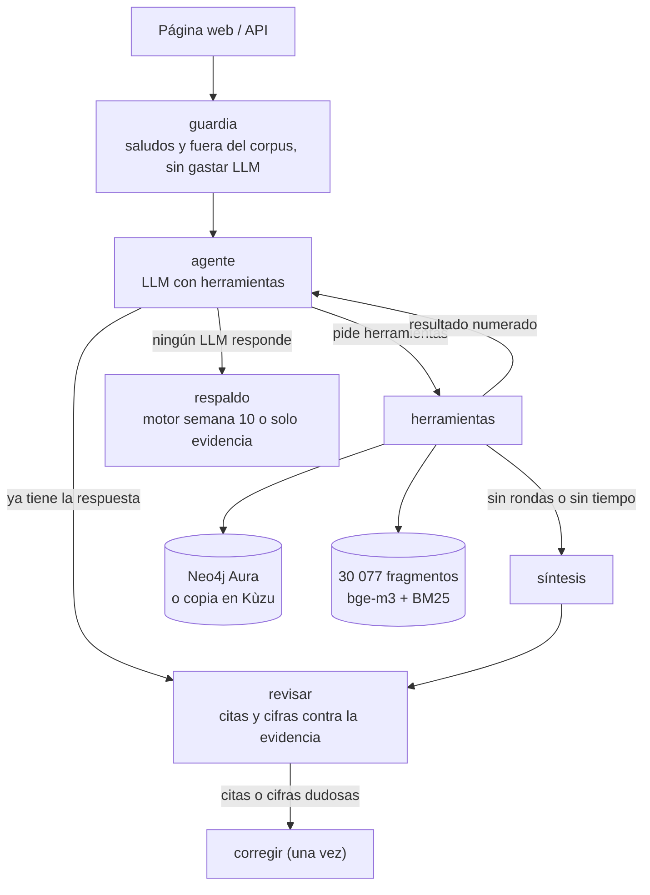

# Semana 11 — Agente con herramientas desplegado en la nube

**Enterprise Brain Glaciares · Grupo G8 · UNMSM**

El GraphRAG de la semana 10 elige una herramienta y responde. Este agente trabaja en un ciclo: elige una herramienta, lee el resultado
y decide si necesita otra. Corre en un contenedor en la nube, con API y página web, y cada dato sigue llevando documento y página.

Esta carpeta es nueva y no cambia nada de las semanas anteriores: solo lee sus datos con `scripts/preparar_datos.py`.
Fuera de ella se agrega un único archivo, `.github/workflows/agente-imagen.yml`, para construir la imagen en GitHub.

> **Sobre el nombre:** el cronograma del grupo lista este entregable en la semana 10 (entrega: domingo 1 de noviembre), pero en el repositorio
> `Semana 10/` ya contiene el GraphRAG y su notebook lo anuncia como "el agente de la semana 11". Por eso la carpeta es `Semana 11/`.

---

## 1. Qué se construyó



| Herramienta | Qué hace | Viene de |
|---|---|---|
| `consulta_verificada` | Consultas Cypher probadas: P1–P10 y E1–E11 | Semanas 7 y 10 |
| `ficha_entidad` | Lo que el grafo sabe de una entidad, con documento y página | Semana 10 |
| `camino_entidades` | La cadena de relaciones que conecta dos entidades | Semana 10 |
| `consulta_libre` | Text2Cypher validado y de solo lectura | Semana 10, con validación más estricta |
| `buscar_documentos` | Búsqueda híbrida con filtros por institución y año | Semana 9 |
| `comparar_superficie` | Cálculo del cambio de superficie glaciar entre inventarios | Semana 10 |
| `buscar_entidad` | Encuentra un nombre mal escrito en el catálogo | Nueva |

### Qué pasa cuando algo falla

| Falla | Qué hace el agente |
|---|---|
| Aura Free se pausa tras 72 horas sin escrituras | Cambia solo a la copia del grafo en Kùzu (6 s medidos en la primera consulta); vuelve a probar Neo4j cada 5 minutos |
| Un LLM agota su cuota o da error | Pasa al siguiente y deja descansar al que falló |
| Ningún LLM responde | Muestra la evidencia sin redactar, siempre con fuente |
| El modelo de embeddings no carga | Sigue buscando solo con BM25 |
| El LLM inventa una cifra o una cita | La verificación lo detecta, pide una corrección y, si persiste, lo avisa en pantalla |
| El LLM responde sin consultar nada | Se le pide usar herramientas; si insiste, no se muestra esa respuesta |
| El LLM entra en bucle | Máximo de 5 rondas y 120 segundos; luego responde con lo reunido |
| Demasiadas preguntas | Límite por IP y total por minuto, turnos simultáneos y caché |
| El LLM escribe una consulta peligrosa | Se rechaza antes de ejecutarse; además, la sesión de Neo4j es de solo lectura |

### Archivos

```text
.github/workflows/agente-imagen.yml     prueba y publica la imagen en GitHub
Semana 11/
├── README.md                           esta guía
├── semana11_agente_glaciares.ipynb     demo: conversa con el servicio desplegado
└── agente_glaciares/
    ├── agente.py                       el ciclo del agente (LangGraph)
    ├── herramientas.py                 las 7 herramientas y la numeración de citas
    ├── llm.py                          cadena de LLM con cambio automático de modelo
    ├── grafo_resiliente.py             Neo4j con respaldo en Kùzu
    ├── rag_ligero.py                   búsqueda de texto con los embeddings de la semana 9
    ├── graphrag_glaciares.py           motor de la semana 10 (copia sin cambios)
    ├── servicio.py · api.py · config.py   servicio, API web y configuración
    ├── static/                         página de chat
    ├── evaluar_agente.py               evaluación y archivos para RAGAS
    ├── banco_preguntas.json            las 18 preguntas de la semana 10
    ├── scripts/                        preparar datos, comprobar claves, recargar Neo4j, desplegar
    ├── tests/                          pruebas automáticas
    ├── Dockerfile · requirements.txt · .env.example
    └── datos/                          se genera; no se sube a GitHub
```

---

## 2. Qué está verificado

| Comprobación | Estado | Resultado |
|---|---|---|
| Agente con Groq, Gemini y Aura reales | ✅ | 7 preguntas en modo agente, con varias herramientas y citas; cambia de Groq a Gemini a mitad de pregunta cuando se agota la cuota |
| Pruebas automáticas | ✅ | 144 pruebas: 122 con LLM simulado y 22 contra un Neo4j 5 local |
| Consultas: Neo4j frente a Kùzu | ✅ | Mismas filas en las 18 consultas |
| Escrituras en Neo4j y consultas lentas | ✅ | Rechazadas y cortadas |
| Contenedor con 2 CPU y 4 GB | ✅ | Listo en 67 s · memoria de 1.4 a 1.8 GiB · 1 a 2 s por pregunta sin LLM |
| Apagar Neo4j y volver a encenderlo en vivo | ✅ | Responde con Kùzu y regresa solo |
| Página web en computador y celular | ✅ | Citas, enlaces y pasos funcionan; sin errores en consola |
| Formato para RAGAS | ✅ | Mismas claves que `ragas_semana10.jsonl` |
| GitHub Actions | ✅ | Pruebas en verde en un entorno limpio e imagen publicada |
| **Azure y Cloud Run** | ⏳ | Necesitan tus cuentas; solo se revisó la sintaxis del script de Azure |
| **Ejecutar la imagen final con modelo incluido y versiones fijadas** | ⏳ | Ya está construida, pero aún no se ha ejecutado. Se comprueba en el paso 5. El contenedor medido arriba tenía el modelo en un volumen |

### Revisa esto: Aura y la copia del grafo no coinciden

| Grafo | Nodos | Relaciones | P2: lagunas de Áncash con riesgo muy alto |
|---|---|---|---|
| Aura (revisado el 31 de octubre) | 13 638 | 35 374 | 4: sin Llaca |
| `Semana 7/grafo_glaciares/*.csv` (copia en Kùzu) | 13 829 | 36 596 | 5: con Llaca |

Aura tiene una curaduría posterior: ya no incluye como lagunas o glaciares entradas de ruido como "Región" o "Bolivia", y agrega propiedades como `nivel_reciente`. Pero también **perdió el nivel de riesgo de Llaca** y de lagunas como Taullicocha o Pacliashcocha, aunque los documentos catalogan a Llaca como de riesgo muy alto. 11 de las 18 consultas verificadas dan resultados distintos en cada grafo.

- **Consecuencia:** las respuestas pueden cambiar si Aura se pausa y el agente pasa a la copia. Una pregunta directa sobre Llaca sí encuentra su riesgo en los documentos, pero P2 no la lista con Aura.
- **Qué debe decidir el grupo:** si Llaca salió de Aura a propósito. Quien hizo la curaduría debe confirmarlo, porque P2 es una pregunta de competencia.
- **Para igualar los grafos:** exporta la versión elegida a CSV y vuelve a construir la imagen. `scripts/cargar_neo4j.py` carga esos CSV en una instancia vacía y no escribe sobre una base que ya tenga datos.

---

## 3. Pautas del entregable

1. **Las claves nunca van al repositorio ni a la imagen.** Solo en `.env` (ignorado por Git) y como secretos de la nube.
2. **No se modifican las semanas anteriores.** Si el grafo cambia, se vuelve a ejecutar `scripts/preparar_datos.py`.
3. **Antes de cada despliegue:** pruebas en verde y `scripts/comprobar_entorno.py` sin fallas.
4. **Cada versión de la imagen lleva su número**, para poder volver atrás.
5. **Toda respuesta se revisa con sus fuentes.** Las pruebas automáticas no reemplazan la evaluación de contenido de la siguiente semana.
6. **Despierta el servicio antes de la demo.** Abre la URL dos minutos antes: sin uso se apaga para no gastar crédito.

---

## 4. Paso a paso

Comandos para PowerShell, desde `Semana 11\agente_glaciares`.

### Paso 1. Consigue las claves

| Clave | Dónde | Obligatoria |
|---|---|---|
| `GROQ_API_KEY` | [console.groq.com/keys](https://console.groq.com/keys) | Al menos una de las dos |
| `GOOGLE_API_KEY` | [aistudio.google.com/apikey](https://aistudio.google.com/apikey) | Al menos una de las dos |
| `NEO4J_URI` y `NEO4J_PASSWORD` | Las del grupo, de la semana 7 ([console.neo4j.io](https://console.neo4j.io)) | No: sin ellas usa la copia en Kùzu |

Son los mismos Secrets de Colab de las semanas anteriores.

```powershell
Copy-Item .env.example .env
notepad .env
```

### Paso 2. Construye la imagen en GitHub

La imagen ocupa cerca de 6 GB y construirla en un computador pide reservar 15 GB. GitHub Actions lo hace gratis y sin usar tu disco.

La rama está en el fork [LuisMendozaAymara/BrainGlaciares](https://github.com/LuisMendozaAymara/BrainGlaciares), porque el repositorio del grupo solo admite escritura de su dueño. Cada cambio se sube así y vuelve a construir la imagen:

```powershell
git push fork entrega-semana-11
```

1. En la pestaña [Actions del fork](https://github.com/LuisMendozaAymara/BrainGlaciares/actions), espera a que **Imagen del agente** termine en verde. Ejecuta las pruebas y publica la imagen.
2. Tu imagen se llama `ghcr.io/luismendozaaymara/brainglaciares-agente:latest`. Ya se puede descargar sin iniciar sesión, así que Azure no necesita credenciales. No contiene claves, y sus datos son los mismos del repositorio público.

<details>
<summary>Alternativa: construirla en tu computador (15 GB libres)</summary>

```powershell
py -3.12 scripts\preparar_datos.py
docker build --target pruebas -t agente-pruebas .
docker run --rm -v "${PWD}:/app" -e DATOS_DIR=/app/datos -e EMBEDDER=ninguno agente-pruebas python -m pytest tests -q
docker build -t agente-glaciares:1.0 .
docker run --rm --env-file .env -p 8080:8080 agente-glaciares:1.0
```

Abre <http://localhost:8080>. Para publicarla, crea una cuenta en [hub.docker.com](https://hub.docker.com):

```powershell
docker login
docker tag agente-glaciares:1.0 TU_USUARIO/agente-glaciares:1.0
docker push TU_USUARIO/agente-glaciares:1.0
```

</details>

### Paso 3. Comprueba tus claves

```powershell
py -3.12 -m venv .venv
.venv\Scripts\pip install pandas neo4j langchain-groq langchain-google-genai
.venv\Scripts\python scripts\comprobar_entorno.py
```

Cada modelo debe aparecer con `OK`, y Neo4j con su número de nodos y relaciones. Si Neo4j falla, reanuda la instancia en [console.neo4j.io](https://console.neo4j.io). Si un modelo ya no existe, quítalo de `AGENTE_MODELOS` en `.env`.

### Paso 4. Despliega en la nube

La imagen es la misma en ambas opciones.

#### Opción A: Azure Container Apps (recomendada, sin tarjeta)

1. Activa [Azure for Students](https://azure.microsoft.com/free/students) con tu correo `@unmsm.edu.pe`.
2. Instala la herramienta y entra a tu cuenta:

   ```powershell
   winget install -e --id Microsoft.AzureCLI
   az login
   ```

3. Despliega. El script lee `.env` y guarda las claves como secretos de Azure:

   ```powershell
   .\scripts\desplegar_azure.ps1 -Imagen ghcr.io/luismendozaaymara/brainglaciares-agente:latest
   ```

Al final muestra la URL pública. Si Azure rechaza la región por una política de la suscripción, consulta las permitidas en *Directivas → Allowed resource deployment regions* del portal y agrega `-Region otra-region`.

#### Opción B: Google Cloud Run (requiere tarjeta)

Instala [gcloud](https://cloud.google.com/sdk/docs/install) y crea `.env.yaml` (Git lo ignora) con tus claves en formato `CLAVE: "valor"`, además de `CARGA_SINCRONA: "1"`. Esta última es necesaria porque Cloud Run frena la CPU cuando no atiende peticiones. La imagen debe estar en Docker Hub, porque Cloud Run no descarga directamente de `ghcr.io`.

```powershell
gcloud run deploy agente-glaciares --image docker.io/TU_USUARIO/agente-glaciares:1.0 --region us-central1 `
  --cpu 2 --memory 4Gi --timeout 300 --concurrency 4 --min-instances 0 --max-instances 1 `
  --cpu-boost --allow-unauthenticated --env-vars-file .env.yaml
```

#### ¿Por qué no Hugging Face Spaces?

Sus [Spaces con Docker ahora requieren un plan de pago](https://huggingface.co/docs/hub/spaces-overview). Si el grupo tiene PRO, la misma imagen sirve agregando `sdk: docker` y `app_port: 8080` al README del Space.

### Paso 5. Verifica el despliegue

```powershell
$URL = "https://TU-SERVICIO"
Invoke-RestMethod "$URL/salud"
Invoke-RestMethod "$URL/api/info" | ConvertTo-Json -Depth 4
```

Confirma en `/api/info`: `estado` en `listo`, `grafo.activo` en `Neo4j`, `texto.busqueda` híbrida y al menos un modelo disponible. Luego abre la URL en el navegador y haz una pregunta del grupo. La documentación interactiva está en `$URL/docs`.

### Paso 6. Ejecuta la evaluación contra la nube

```powershell
py -3.12 evaluar_agente.py --url $URL --salida resultados
```

Deja `respuestas_agente.csv`, `reporte_agente.md` y `ragas_semana11.jsonl`. Este último es la entrada para la evaluación integral de la siguiente semana. Para las 30 preguntas: `--banco banco_30.json`, una lista de `{"id", "tipo", "pregunta"}`.

El plan gratuito de Groq admite 8 000 tokens por minuto y cada llamada usa de 3 000 a 5 500. Con varias preguntas seguidas el agente pasa a Gemini o espera unos segundos. Para que la evaluación use más Groq, agrega `--pausa 20`.

### Paso 7. Entrega

1. Pega la URL pública en la primera celda de `semana11_agente_glaciares.ipynb` y ejecútalo en Colab para dejar las salidas guardadas.
2. Agrega el notebook, la carpeta `resultados/` y, al final de este README, la URL y los resultados de `reporte_agente.md`.
3. Sube los cambios con `git push fork entrega-semana-11` y abre el PR desde el fork hacia `EdsonPerez7/BrainGlaciares`.

---

## 5. Uso de la API

```powershell
$cuerpo = @{ pregunta = "¿Qué lagunas de Áncash tienen riesgo muy alto?"; sesion_id = "demo-0001" } | ConvertTo-Json
Invoke-RestMethod "$URL/api/preguntar" -Method Post -ContentType "application/json; charset=utf-8" `
  -Body ([Text.Encoding]::UTF8.GetBytes($cuerpo))
```

| Campo de la respuesta | Significado |
|---|---|
| `respuesta` | Texto con citas `[n]` |
| `fuentes` | Evidencia numerada: tipo, referencia, documento, página, enlace y si fue citada |
| `pasos` | Cada decisión, herramienta y verificación |
| `modo` | `agente`, `graphrag` (respaldo con LLM), `evidencia` (sin LLM) o `guardia` (no hizo falta LLM) |
| `avisos` | Lo que la verificación no pudo confirmar |

---

## 6. Solución de problemas

| Síntoma | Causa probable | Qué hacer |
|---|---|---|
| El indicador dice "Despertando" | El servicio estaba apagado | Espera alrededor de un minuto |
| El indicador dice "Kùzu" | Neo4j en pausa o sin configurar | Reanuda la instancia en console.neo4j.io; vuelve solo en 5 minutos |
| `sin LLM: modo evidencia` | Claves ausentes o cuotas agotadas | Revisa `/api/info` → `modelos` y ejecuta `comprobar_entorno.py` |
| El contenedor se reinicia | Memoria insuficiente | Asigna 4 GB, o usa `EMBEDDER=ninguno` (solo BM25) |
| Error 429 | Límite por minuto | Espera, o sube `LIMITE_IP_MIN` para la demo |
| La instancia de Aura desapareció | Pasó 30 días en pausa | Crea otra y ejecuta `scripts/cargar_neo4j.py` |
| Actions falla por falta de permiso al publicar | El fork limita `GITHUB_TOKEN` | Activa *Settings → Actions → Workflow permissions → Read and write* en el fork |
